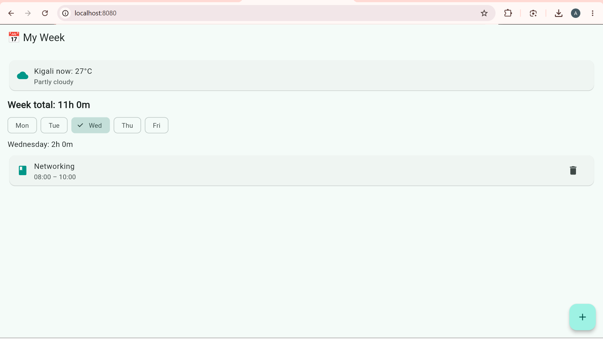
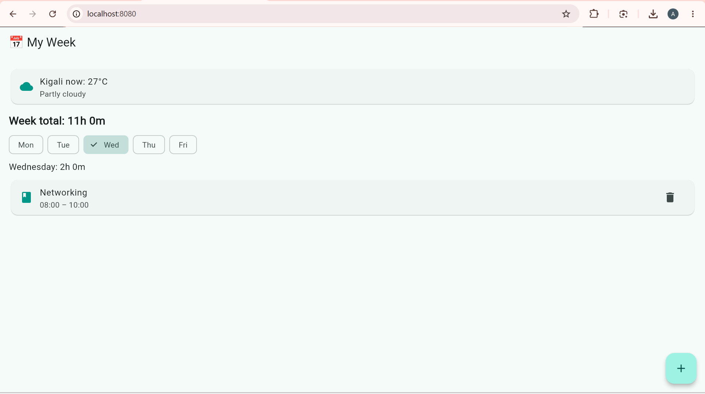
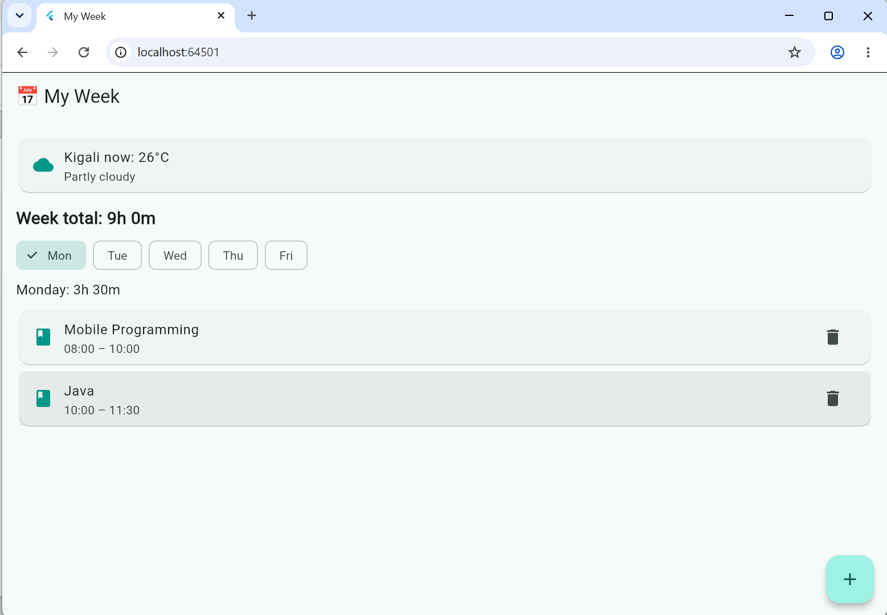
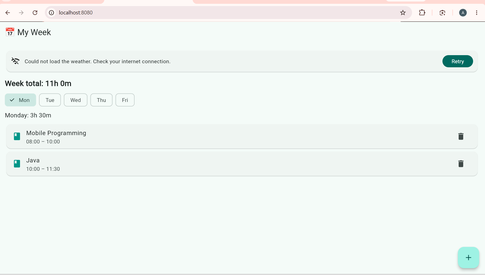

# My Week

My Week is a weekly timetable app: add, edit and delete your courses, see the hours per day and per week, and spot time clashes. My data is now saved on the phone with shared_preferences,
so nothing is lost when the app closes, and it shows the live weather in Kigali from the Open-Meteo API.

## Screenshots

