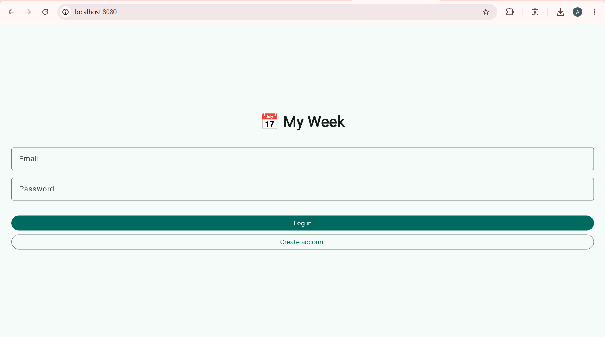
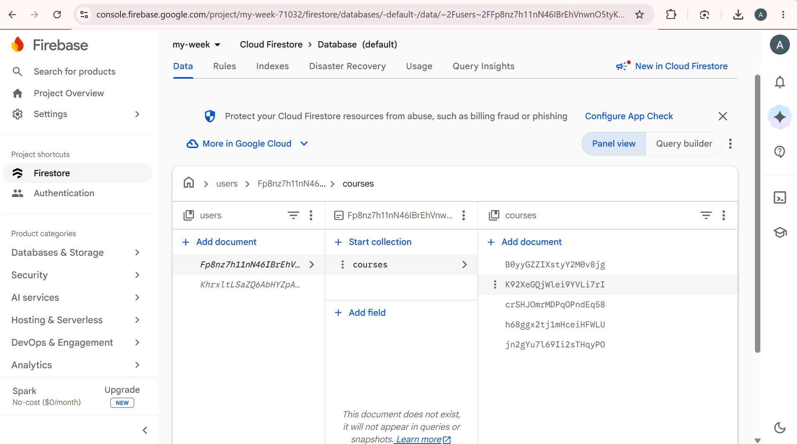
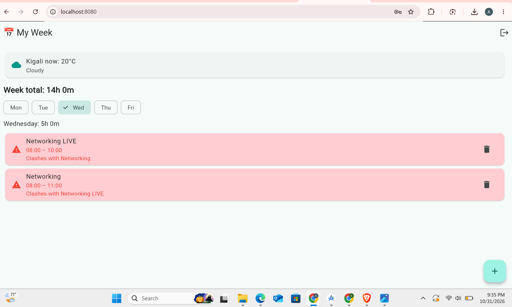
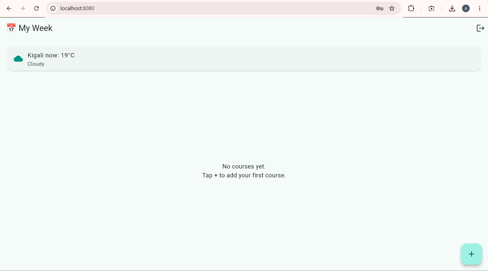

# My Week

My Week is a weekly timetable app: add, edit and delete your courses, see the hours per day and per week, spot time clashes, and see the live weather in Kigali. It signs users in with Firebase Authentication, and each user's data is saved in Cloud Firestore under their own id, so two accounts never see each other's data, and every change appears live.

## Screenshots

